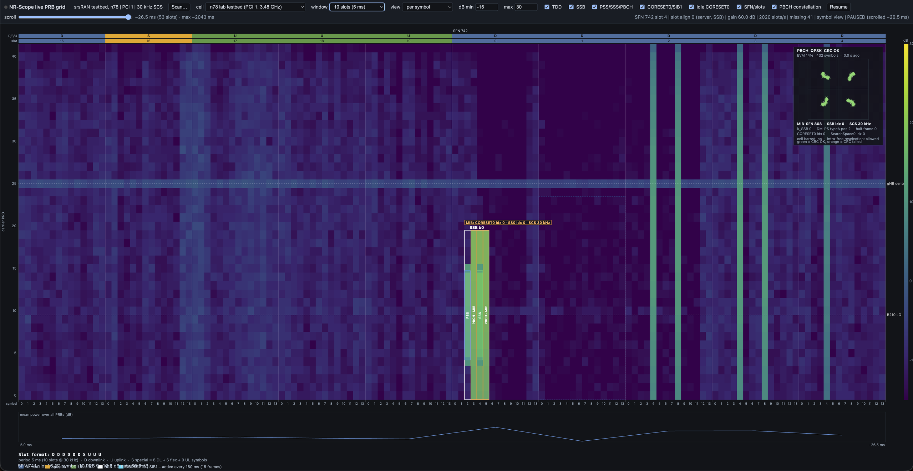

# prbviz - live 5G NR resource-grid visualizer

A web viewer that shows what a 5G NR cell is doing on the air, in real time: a per-PRB power waterfall
(per slot or per OFDM symbol) with TDD, SSB and CORESET0 overlays, plus a live PBCH constellation.

It is a trimmed, self-contained copy of **NR-Scope** (Princeton, srsRAN-4G based) with a few taps added,
and a small web server that turns the tapped data into a labelled browser view.

```
USRP B210 ──► nrscope ───────────────► ZeroMQ PUB tcp://127.0.0.1:5556 ──► server/server.py ──HTTP :8080──► browser
              (src/nrscope/.../prb_power_dump.cc)   topics: prb, sym, pbchc      (SUB → reorder by slot → SSE)
```

Tested on a Raspberry Pi 5 host with a USRP B210 against an N78 lab gNB (and a commercial n41 cell, config included).



*The viewer on the n78 lab testbed (PCI 1, 30 kHz SCS), per-symbol view, 20 slots (10 ms), paused and scrolled back 55 ms.
Top: the toolbar in three rows (cell and live status; window, view, colour scale and overlay chips; the scroll-back row while paused). Under it: the TDD slot strip (`D D D D D D S U U U`, 5 ms period) with slot numbers and the SFN. Grid: carrier PRBs against OFDM symbols, colour = power.
White box: SSB beam 0 with PSS, PBCH+MIB, SSS, PBCH+MIB; the orange label is the CORESET0/SearchSpace0 index decoded from the MIB; the dashed box is the CORESET0 / SIB1 occasion (SIB1 here every 160 ms).
Dotted lines: the B210 LO and the gNB centre. The cyan label above the CORESET0 box is the exact PDCCH from the decoder (DCI format, RNTI, CCE range, aggregation level). Right: the equalised PBCH QPSK constellation (CRC OK) with the decoded MIB, docked next to the grid (the "PBCH constellation" chip hides it). Bottom: mean power per symbol, the slot format and the legend.*

## Contents

1. [Quick start](#quick-start)
2. [What the viewer shows](#what-the-viewer-shows)
   (cell scan from the GUI: [Scan for cells from the GUI](#scan-for-cells-from-the-gui-nrscan--sib1))
3. [Layout](#layout)
4. [Data path and wire formats](#data-path-and-wire-formats)
5. [How nrscope decodes the cell (block diagrams with C functions)](#how-nrscope-decodes-the-cell)
6. [Timing tracker fix (why SIB1 used to stop after about 14 s)](#timing-tracker-fix)
7. [How often is CORESET0 / SIB1 sent?](#how-often-is-coreset0--sib1-sent)
8. [Modulation notes](#modulation-notes)
9. [Environment variables](#environment-variables)
10. [Known issues and open items](#known-issues-and-open-items)

## Quick start

```
scripts/build.sh                  # once: cmake + make nrscope nrscan   (about 100 s on the Pi)
scripts/start.sh                  # server + nrscope; open http://<host>:8080/
scripts/stop.sh                   # stop both (the B210 is exclusive, always stop before scanning)
scripts/switch.sh n41_pci610      # restart on another cell of config/cells.json (the viewer's cell dropdown does the same)
scripts/scan.sh config/xxx.yaml   # nrscan cell search
scripts/scan_plmn.py config/xxx.yaml   # nrscan + SIB1 of every cell found: PLMN list, TAC, cell identity (viewer is not restarted)
```

* `scripts/start.sh [config.yaml]` defaults to `config/testbed_n78.yaml`. It copies the config to `run/config.yaml`
  (nrscope reads `./config.yaml`), starts the server, then starts nrscope through `scripts/nrscope_loop.sh`,
  a wrapper that restarts nrscope if it exits (for example after a RACH decode crash).
* **Choosing the cell / band.** `config/cells.json` lists the cells the viewer can show (`id`, `name`, `band`, nrscope `config`, viewer `meta`).
  The viewer shows them in the *cell* dropdown; choosing one restarts the web server and nrscope on that cell (`scripts/switch.sh`, log `run/switch.log`),
  re-tunes the B210 and reloads the page after 15-40 s. It affects everybody watching this server. Only ids from `cells.json` are accepted
  (`POST /select`, same-origin only; `GET /cells` lists them). To add a band, add a nrscope yaml + a meta json and one entry in `cells.json`.
  The running cell is remembered in `run/cell.id` (written by `start.sh`).
* Logs: `run/logs/nrscope.log` (rotated by `scripts/rotlog.py`: 5 files of 20 MB, `nrscope.log` and `.1` ... `.4`; `NRSCOPE_LOG_MB` / `NRSCOPE_LOG_KEEP` change that; the previous run is rotated away at start), `run/logs/server.log` (restarted with the server, a few KB per hour). Build log: `build.log` (ends with `BUILD_DONE`).
* Use the lowest GSCN of a cluster reported by `nrscan`. nrscope on a wrong GSCN prints repeated RF overflows and exits.
* The radio is exclusive: scan, validate and live view cannot run at the same time.

Current testbed: gNB PCI 1, SSB at 3483.84 MHz (ARFCN 632256, GSCN 7835), 30 kHz SCS, TDD
(`D D D D D D S U U U`, 5 ms period), external reference clock. The commercial n41 cell is in
`config/n41_pci610.yaml` with `config/meta_n41_pci610.json`.

## What the viewer shows

* **Per-slot waterfall.** One row per slot, one column per PRB, colour = mean power (dB). Overlays can be toggled:
  TDD pattern (`ov_tdd`), SSB (`ov_ssb`), CORESET0 (`ov_cs0`), frame boundaries (`ov_frm`), constellation (`ov_const`).
* **Per-symbol view** ("view: per symbol"). Each slot is drawn as 14 columns, so PSS/SSS/PBCH and CORESET0 symbols are
  visible. Use windows of 4 to 40 slots (4 slots = 2 ms). The SSB box follows the symbols that are actually loud in the SSB
  PRBs, because the SSB symbol position moves between runs (see the timing note below). The CORESET0 box uses
  `coreset0.sym_start` / `nsym` from the meta file, which are nominal and not yet verified on the testbed.
* **PSS / SSS / PBCH (MIB) overlay** (overlay chip "PSS / SSS / PBCH", per-symbol view only). Inside each SSB box the 4 SSB symbols are split into
  PSS (symbol 0, centre 127 subcarriers), PBCH (symbols 1 and 3 over all 20 PRBs, symbol 2 over the outer 4 PRBs on each side) and SSS
  (symbol 2, centre 127 subcarriers). The MIB is carried by the PBCH. Use a 4-slot window so the symbols are wide enough to read; the
  PBCH columns are labelled "PBCH · MIB" (rotated when narrow) and a callout above the first SSB box of each slot shows the decoded MIB
  (CORESET0 idx, SS0 idx, SCS, cell barred); the callout is also drawn in the per-slot view. The
  sub-boxes are drawn from the nominal SSB layout (they ignore `k_SSB`, so edges can be off by a few subcarriers).
* **MIB fields.** Under the PBCH constellation the viewer prints the decoded MIB: SFN, SSB index, common SCS, `k_SSB`, DM-RS type-A position,
  CORESET0 and SearchSpace0 indices, cell-barred and intra-frequency-reselection flags. They are only updated from frames whose CRC is OK.
* **Pause and scroll.** Pause freezes a copy of the 4096-slot history (about 2 s at 30 kHz SCS). While paused a *scroll back* row appears under the toolbar;
  the plot can also be dragged with the mouse, scrolled with the wheel (or a horizontal trackpad swipe) or moved with the arrow keys
  (Shift = half a window, PageUp/PageDown = one window, Home/End = oldest/newest). The scroll-back readout shows the offset from the frozen newest slot.
  **Jump to CORESET0:** when you press Pause the view scrolls to the newest *active* CORESET0 / SIB1 occasion in the frozen history (untick *Jump to CORESET0 on pause* to stay at the newest slot).
  The buttons **< CORESET0** and **CORESET0 >** (keys `[` and `]`) step to the previous or next active occasion, centred in the window; a short message shows which one of how many (e.g. 12 of 13). An occasion counts as active by the same test as the box colour (more than 8 dB above the neighbouring PRBs).
  On the testbed SIB1 comes every 160 ms, so the 2 s history holds about 13 occasions; on n41 (every 20 ms per beam) there are many more.
* **PBCH constellation.** The equalised PBCH symbols (432 QPSK points per SSB) with the PBCH CRC result and an EVM computed on
  the server. One frame is produced per SSB period, so it updates continuously, a few frames per second (throttled to 10 per second;
  the newest frames are drawn brightest). The panel shows the last 8 frames. It needs nothing but a decoded PBCH, so it also works on cells
  where SIB1 cannot be decoded. EVM is much worse than the SIB1 PDSCH EVM was on the strong lab gNB (about 35-45 % on the weak
  commercial n41 cell) because PBCH is heavily coded and still decodes at low SNR: judge the cell by the cluster shape and CRC, not by EVM alone.

### CORESET0 in detail: REGs, CCEs and DMRS

Tick **REG/CCE/DMRS** (per-symbol view, window of about 10 slots or less) to see what is inside the CORESET0 box of an occasion:

* **Geometry from the MIB.** The box is no longer taken from the meta file: the viewer reads the decoded MIB (CORESET0 index, SS0 index, SSB index) and looks up TS 38.213 tables 13-1..13-4 (PRBs, symbols, offset from the SSB) and 13-11 (first symbol), the same tables as `phy_common_nr.c`.
  The MIB callout shows the result, e.g. `CORESET0 idx 0 ... (24 PRB x 2 sym)`. Only the SCS combinations 15/15, 15/30, 30/15 and 30/30 kHz (SSB/PDCCH) are covered; for others the meta file is used. The occasion slots still come from the meta file.
* **REG** = 1 PRB x 1 symbol (12 REs), i.e. one cell of the per-symbol grid. Faint lines separate REGs when zoomed in far enough.
* **CCE** = 1 REG bundle = 6 REGs (CORESET0 uses bundle size 6, interleaver size 2, shift = PCI; TS 38.211 7.3.2.2). REGs are numbered time first, so on the testbed (24 PRB x 2 symbols) a bundle is 3 PRBs x 2 symbols.
  Bundle `b` carries CCE `i` with `b = (r*C + c + PCI) mod nB`, `i = 2c + r`, `C = nB/2`. The label `C<i>` in every bundle is that CCE number.
* **Active CCEs.** A bundle is drawn bright when its mean power is more than 8 dB above the PRBs next to CORESET0 in the same symbols; the label above the box then reads e.g. `PDCCH CCE 0-3 - AL 4`.
  On the testbed this matches the SIB1 DCI exactly: PRBs 3-8 and 15-20 of symbols 0-1, which is CCEs 0-3 (aggregation level 4).
* **Exact CCEs from the decoder.** nrscope publishes every DCI it decodes on the `dci` topic (RNTI, RNTI type, DCI format, CORESET id, first CCE, aggregation level). When the viewer has such an event for a CORESET0 slot it uses it instead of the power test, and the label reads e.g. `DCI 1_0 SI-RNTI 0xffff - CCE 0-3 - AL 4` (testbed) or `... CCE 0-7 - AL 8` (n41). Slots without an event fall back to the power test (`PDCCH CCE ... - AL ...`), so the two labels tell you which one you are looking at.
  Sources: SI-RNTI (SIB1), C-RNTI grants of the known UEs (DL and UL), and Msg4 TC-RNTI grants whose PDSCH decoded. Only CORESET 0 is drawn, because the geometry of the other CORESETs comes from RRC and is not in the meta. To keep the CPU load down the SI-RNTI search runs only in the slot positions (mod 320) that decoded before, plus a full search for 160 ms every ~10 s to learn new ones; on the testbed a few percent of the SIB1 occasions are not decoded and fall back to the power test.
* **Signal block** (under the decoded MIB in the PBCH panel). SNR (SSB), SSB RSRP and CFO are nrscope's own measurements of the SSB (topic `meas`; RSRP is relative to the ADC full scale at the current RX gain, not dBm). SNR (from PBCH EVM) is only an estimate, -20 log10(EVM). DL/UL MCS, grant size (PRBs from the RIV of resource allocation type 1) and DL retransmissions come from the C-RNTI DCIs that nrscope decodes, so they need a UE whose Msg4 nrscope saw; MCS table 1 is assumed. CQI and uplink SINR are sent by the UE on the uplink and are not visible to a downlink sniffer: they have to come from the gNB.
* **DMRS.** The red dots are the PDCCH DMRS positions, subcarriers 1, 5 and 9 of every REG (25 % of the REs). They are drawn from the standard, not measured: the grid has one value per PRB, so real DMRS power would need a per-subcarrier tap in nrscope. The dots are only drawn in windows of **10 slots or less** (zoom in with the Window selector); in wider windows the symbol columns are too narrow and the dots would turn into red stripes. While the REG/CCE/DMRS chip is on and the window is wider, the status line above the grid reminds you ("DMRS dots: window ≤ 10 slots"). The REG lines need a PRB row of at least 10 px.

## Layout

| path | content |
|---|---|
| `src/` | NR-Scope + srsRAN-4G subset (lib, srsue, srsenb, srsgnb, nrscope, cmake); built with CMake |
| `build/` | out-of-tree build (`nrscope`, `nrscan` in `build/nrscope/src/`) |
| `server/` | `server.py` (stdlib + pyzmq), `index.html` (live view), `demo.html` (replay, outdated), `meta.json` (cell layout / overlays) |
| `config/` | nrscope configs and viewer meta files: `testbed_n78.yaml`, `meta_testbed.json`, `n41_pci610.yaml`, `meta_n41_pci610.json`, `n41_reference.yaml` |
| `scripts/` | `build.sh`, `launch_build.sh` (background build), `start.sh`, `stop.sh`, `scan.sh`, `nrscope_loop.sh` |
| `run/` | runtime dir: config copy, pids, logs |
| `docs/` | decoded MIB/SIB1 notes |
| `old/` | local backups of every file changed during development (not in the git repo) |

Files changed or added in nrscope / srsRAN:

| file | change |
|---|---|
| `src/nrscope/src/libs/prb_power_dump.cc`, `hdr/prb_power_dump.h` | ZeroMQ publisher, per-slot power, per-symbol power, `pbch_const_tap()` (PBCH constellation), `send_pdsch_constellation()` (SIB1, no longer used by the viewer) |
| `src/lib/src/phy/phch/pbch_nr.c`, `include/srsran/phy/phch/pbch_nr.h` | new hook `srsran_pbch_nr_const_cb(symbols, n, crc_ok, mib_fields)`, called after every PBCH decode with the equalised symbols and the unpacked MIB |
| `src/nrscope/src/libs/sibs_decoder.cc` | calls `send_pdsch_constellation()` after each successful SIB1 PDSCH decode; keeps decoding when `NRSCOPE_SIB1C` is set (off by default) |
| `src/nrscope/src/libs/nrscope_worker.cc` | SIB1 thread keeps running when `NRSCOPE_SIB1C` or `NRSCOPE_SIB1DBG` is set |
| `src/nrscope/src/libs/radio_nr.cc` | optional sync debug print (`NRSCOPE_CFO_DBG`), token-leak fix |
| `src/lib/src/phy/ue/ue_sync_nr.c` | **timing tracker fix** (see below) |

## Data path and wire formats

nrscope PUB **binds** `NRSCOPE_ZMQ`, so the server can start and restart at any time and ZeroMQ reconnects.
A remote consumer can subscribe with `ZMQ_ENDPOINT=tcp://0.0.0.0:5556` (no authentication: keep it on a trusted LAN).

All topics are two-frame ZeroMQ messages (topic, payload) with the same 22-byte little-endian header:

```
struct "<HBBQHBBhHH":  u16 magic 0x5052 | u8 ver | u8 flags | u64 abs_slot | u16 sfn | u8 slot_idx | u8 rsvd
                       | i16 gain_x10 | u16 prb_lo | u16 nprb
abs_slot = (sf_round*1024 + sfn) * 20 + slot_idx        (30 kHz SCS, 20 slots per frame)
```

| topic | ver | payload after the header | used for |
|---|---|---|---|
| `prb` | 1 | `nprb` x u8, mean power per PRB, `q = (dB + 100) * 1.8`, `0` = missing (`dB = q/1.8 - 100`) | per-slot waterfall |
| `sym` | 2 | `flags` (= 14) x `nprb` bytes, same encoding, one row per OFDM symbol | per-symbol view (`NRSCOPE_SYM=1`) |
| `pbchc` | 6 | equalised PBCH symbols as int8 I/Q pairs (432 per frame), flags bit0 = CRC ok, bit7 = MIB trailer present, `prb_lo` = number of symbols, float32 at offset 22 unused, optional trailer after the symbols: 10 x u32 (sfn, ssb_idx, hrf, scs_common, k_ssb, dmrs_typeA_pos, coreset0_idx, ss0_idx, cell_barred, intra_freq_reselection) | PBCH constellation (`NRSCOPE_PBCHC=1`) |
| `dci` | 7, 8 | one DCI per message, after the 22-byte header: u16 rnti, u8 rnti_type (0 C, 1 P, 2 SI, 3 RA, 4 TC), u8 format (0 0_0, 1 0_1, 2 1_0, 3 1_1), u8 coreset_id, u8 L (log2 of the aggregation level), u16 first CCE, u8 dir (0 DL, 1 UL), u8 ss_type, u16 reserved; version 8 adds 12 bytes: u8 flags (bit0 = grant fields valid), u8 mcs, u8 ndi, u8 rv, u8 HARQ pid, u8 time-domain assignment, u16 BWP size in PRBs (0 = unknown), u32 frequency-domain assignment (RIV) | exact CCEs in CORESET0 (`NRSCOPE_DCI=1`); the server relays batches to pages that open `/stream?dci=1` |
| `meas` | 8 | measurements of every tracked SSB: 6 x float32 (rsrp_dB, epre_dB, n0_dB, snr_dB, cfo_hz, delay_us; dB relative to full scale), u32 nof_re, u32 ssb_idx; flags bit0 = PBCH CRC ok | Signal block of the PBCH panel (`NRSCOPE_PBCHC=1`) |
| `sib1c` | 5 | equalised SIB1 PDSCH symbols (up to 4000 per frame) | not subscribed by the server any more (`NRSCOPE_SIB1C=1`) |
| `iq` | 3 | raw cf32 around the SSB | disabled (the server ignores it, `NRSCOPE_SSB_PRB` is no longer set) |

Browser side: the server reorders rows by absolute slot and pushes them over Server-Sent Events.

* `/stream` per-slot rows only.
* `/stream?sym=1` adds per-symbol rows (only sent to browsers that ask, so the normal view costs nothing extra).
* `/stream?iq=1` adds PBCH constellation frames (`iq` here means "send the constellation"); the last 4 frames are replayed first, tagged with their `age`.

Server arguments: `--zmq <endpoint> --http <host:port> --meta <meta.json>`. Environment for `start.sh`: `ZMQ_ENDPOINT`
(default `tcp://127.0.0.1:5556`), `HTTP` (default `0.0.0.0:8080`), `META` (default `server/meta.json`).

## How nrscope decodes the cell

nrscope follows the standard UE receive chain. The two diagrams below give, for every block, the C function that
implements it in this source tree. They were checked by grepping the code, not by reading each algorithm.

### 1. SSB to MIB

```
 waveform
    │
    ▼
┌─────────────────────────┐   srsran_ssb_find() → ssb_pss_find()        (ssb.c, called by ue_sync_nr_run_find)
│ PSS search + CFO fix    │   srsran_vec_apply_cfo()                    (ue_sync_nr.c, ue_sync_nr_recv)
└───────────┬─────────────┘
            ▼
┌─────────────────────────┐
│ OFDM demodulation       │   ssb_demodulate()                          (ssb.c)
└───────────┬─────────────┘
            ▼
┌─────────────────────────┐
│ SSS search  (N_ID(1))   │   srsran_sss_nr_find()                      (called from ssb.c)
└───────────┬─────────────┘
            ▼
┌─────────────────────────┐   srsran_dmrs_pbch_measure()   (i_SSB)
│ PBCH DM-RS search,      │   srsran_dmrs_pbch_estimate()  (channel + noise)
│ channel + noise est.    │
└───────────┬─────────────┘
            ▼
┌─────────────────────────┐   srsran_pbch_nr_decode()                   (extract, equalise, demod, polar, CRC)
│ PBCH extract, equalise, │   called by ssb_decode_pbch()               (ssb.c)
│ demod, BCH decode       │   constellation tap: srsran_pbch_nr_const_cb → pbch_const_tap()   (pbch_nr.c, prb_power_dump.cc, added)
└───────────┬─────────────┘
            ▼
┌─────────────────────────┐   srsran_pbch_msg_nr_mib_unpack()           (nrscope task_scheduler.cc)
│ MIB                     │
└─────────────────────────┘

 Tracking loop (not in the reference diagram, runs in TRACK state, once per SSB period):
 srsran_ssb_track() → ue_sync_nr_update_ssb() → ue_sync_nr_apply_feedback()      (ue_sync_nr.c)
```

| block | function | file |
|---|---|---|
| PSS search | `srsran_ssb_find()` → `ssb_pss_find()` | `src/lib/src/phy/sync/ssb.c` |
| CFO correction | `srsran_vec_apply_cfo()` | `src/lib/src/phy/ue/ue_sync_nr.c` |
| OFDM demodulation | `ssb_demodulate()` | `ssb.c` |
| SSS search | `srsran_sss_nr_find()` | called from `ssb.c` |
| PBCH DM-RS | `srsran_dmrs_pbch_measure()`, `srsran_dmrs_pbch_estimate()` | called from `ssb.c` |
| PBCH decode | `srsran_pbch_nr_decode()` via `ssb_decode_pbch()` | `ssb.c` |
| MIB | `srsran_pbch_msg_nr_mib_unpack()` | `src/nrscope/src/libs/task_scheduler.cc` |
| tracking | `srsran_ssb_track()`, `ue_sync_nr_update_ssb()`, `ue_sync_nr_apply_feedback()` | `ssb.c`, `ue_sync_nr.c` |

### 2. MIB to SIB1

```
 MIB, i_SSB
    │
    ▼
┌─────────────────────────┐   srsran_coreset_zero()                     (task_scheduler.cc)
│ CORESET0 / search space │   srsran_ue_dl_nr_set_pdcch_config()        (ue_dl_nr.c)
└───────────┬─────────────┘
            ▼
┌─────────────────────────┐
│ OFDM demodulation       │   srsran_ue_dl_nr_estimate_fft_nrscope()    (ue_dl_nr.c, common SCS, per slot)
└───────────┬─────────────┘
            ▼
┌─────────────────────────┐   srsran_dmrs_pdcch_estimate_nrscope()
│ PDCCH DM-RS             │   srsran_dmrs_pdcch_get_ce()
│ channel + noise est.    │
└───────────┬─────────────┘
            ▼
┌─────────────────────────┐   srsran_pdcch_nr_decode()                  (pdcch_nr.c)
│ PDCCH extract, equalise,│   via srsran_ue_dl_nr_find_dl_dci()         (ue_dl_nr.c, rnti = 0xFFFF = SI-RNTI)
│ demod, DCI decode       │
└───────────┬─────────────┘
            ▼
┌─────────────────────────┐   candidate loop inside srsran_ue_dl_nr_find_dl_dci();
│ CRC == SI-RNTI ?        │   "no" → next PDCCH candidate
└───────────┬─────────────┘
            ▼ yes
┌─────────────────────────┐   srsran_ra_dl_dci_to_grant_nr()            (sibs_decoder.cc)
│ DCI → PDSCH grant,      │
│ DM-RS configuration     │
└───────────┬─────────────┘
            ▼
┌─────────────────────────┐   srsran_dmrs_sch_estimate()                (dmrs_sch.c)
│ PDSCH DM-RS             │   inside srsran_ue_dl_nr_decode_pdsch()
│ channel + noise est.    │
└───────────┬─────────────┘
            ▼
┌─────────────────────────┐   srsran_pdsch_nr_decode()                  (pdsch_nr.c)
│ PDSCH extract, equalise,│   constellation tap: send_pdsch_constellation()   (prb_power_dump.cc, added)
│ demod, DL-SCH decode    │
└───────────┬─────────────┘
            ▼
┌─────────────────────────┐
│ SIB1                    │   sibs_decoder.cc (SIB1 thread)
└─────────────────────────┘
```

| block | function | file |
|---|---|---|
| CORESET0 / search space | `srsran_coreset_zero()`, `srsran_ue_dl_nr_set_pdcch_config()` | `task_scheduler.cc`, `src/lib/src/phy/ue/ue_dl_nr.c` |
| OFDM demodulation | `srsran_ue_dl_nr_estimate_fft_nrscope()` | `ue_dl_nr.c` |
| PDCCH DM-RS | `srsran_dmrs_pdcch_estimate_nrscope()`, `srsran_dmrs_pdcch_get_ce()` | `ue_dl_nr.c` (calls) |
| PDCCH decode + SI-RNTI check | `srsran_pdcch_nr_decode()` via `srsran_ue_dl_nr_find_dl_dci()` | `src/lib/src/phy/phch/pdcch_nr.c`, `ue_dl_nr.c` |
| DCI to grant | `srsran_ra_dl_dci_to_grant_nr()` | `sibs_decoder.cc` |
| PDSCH DM-RS | `srsran_dmrs_sch_estimate()` | `src/lib/src/phy/ch_estimation/dmrs_sch.c` |
| PDSCH decode | `srsran_pdsch_nr_decode()` | `src/lib/src/phy/phch/pdsch_nr.c` |
| constellation tap | `send_pdsch_constellation()` | `prb_power_dump.cc` |

Notes on the mapping:

* The PDCCH decode and the "CRC == SI-RNTI?" decision are one function call in the code: `srsran_ue_dl_nr_find_dl_dci()` loops over the candidates.
  Other RNTIs use the `_nrscope` and `_nrscope_dciloop` variants (`dci_decoder.cc`, `rach_decoder.cc`).
* `srsran_ue_dl_nr_decode_pdsch()` runs the PDSCH DM-RS estimate and the PDSCH decode together.
* nrscope keeps going after SIB1 (other SIBs, RACH, per-UE DCIs). The reference diagrams stop at SIB1.
* Threading differs from the diagrams: one thread does sync per subframe, worker threads handle each slot, and there is a separate SIB1 thread.

## Timing tracker fix

**Symptom.** The SIB1 constellation (the first version of the constellation panel) was clean for about 14 s after every nrscope start, then SIB1 decoding stopped
(EVM 6 % → 35 %, then PDCCH CRC failures). The SSB symbol position in the per-symbol view also kept moving.

**Cause.** The B210 and the gNB clocks differ by about 0.2 ppm, so the receive window slides against the air signal by
4-5 samples per second (CFO about 750 Hz at the start). Once the offset exceeds the cyclic prefix (2.34 µs at 30 kHz SCS)
PDCCH/PDSCH decoding fails. `ue_sync_nr` should correct this from every SSB, but in nrscope's modified sync loop
(`srsran_ue_sync_nr_zerocopy_twinrx_nrscope`) the subframe counter is wrapped *after* the state machine runs, so the
subframe that holds the SSB reaches `ue_sync_nr_run_track()` with `sf_idx == 10` instead of `0`. The test
"is this the SSB subframe" never matched, no SSB measurement was ever made in TRACK state, and delay and CFO stayed frozen
(`delay_us = -0.151`, `cfo_hz = 197.5` for the whole run).

**Fix** (`src/lib/src/phy/ue/ue_sync_nr.c`, `ue_sync_nr_run_track()`):

* wrap `sf_idx` and `sfn` locally (`cur_sf`, `cur_sfn`) before testing for an SSB opportunity;
* correct the periodicity test: `sfn % (periodicity_ms / 10) == 0` (the old expression had an operator-precedence error).

**Result.** PBCH CRC is OK at every SSB, delay stays within about ±0.03 µs, CFO is re-estimated every period, and more than
60 s after the start the SIB1 constellation was still updating live (108 frames in 20 s at 3-5 % EVM).
The original file is saved as `old/ue_sync_nr.c.bak_dbg` / `bak_dbg2`.
A second way to avoid the drift would be a common 10 MHz reference for the gNB and the B210.

Debug: `NRSCOPE_CFO_DBG=1` prints `SYNCDBG ... cfo_hz delay_us sfn sf` every 200th call and, from the tracker,
`TRACKDBG opp crc_ok crc delay_us cfo_hz nof_re` (`nof_re = 254` is PSS + SSS, the REs used for the delay/CFO measurement).

## How often is CORESET0 / SIB1 sent?

The period is **measured, not assumed**. The viewer compares the CORESET0 PRBs with the PRBs next to them in the same slot; an occasion is
*active* when the difference is above 8 dB. Active occasions are drawn as a bright, filled cyan box (with the excess in dB when there is room for
the label), idle ones as a faint dashed box (the "Idle CORESET0" chip hides them), and the legend shows the median distance between active frames,
for example `CORESET0 / SIB1 - active every 160 ms (16 frames)`. A cell that repeats SIB1 every 20 ms shows `every 20 ms (2 frames)` without any change.

`scripts/cs0_interval.py [seconds]` does the same offline from the live stream and prints the interval histogram. On the lab testbed (CORESET0 idx 0,
SS0 idx 0, SSB every frame) SIB1 PDCCH + PDSCH is in slot 1 of frames with SFN mod 16 = 0, i.e. once per nominal SIB1 period of 160 ms with no repetitions
in between (75 of 75 such frames were 10.5 dB or more above the neighbouring PRBs). Other CORESET0 users (RAR / Msg4 of a random access, paging) show up
as extra active occasions at other SFNs; they are only sent when needed. The meta file only gives the nominal occasion (slot and PRBs), so without the
activity test most boxes would be empty.

**n41 (commercial cell, decoder result).** `scripts/sib1_period.py` listens to the `sib1c` topic that nrscope publishes for every decoded SIB1
(start nrscope with `NRSCOPE_SIB1C=1`, e.g. `NRSCOPE_SIB1C=1 scripts/switch.sh n41_pci610`, and restart without it afterwards). In 60 s on PCI 610 it
decoded 14884 SI-RNTI DCIs, 13997 of them with PDSCH CRC OK (QPSK). They sit exactly at the nominal occasions of SSB beams 0, 1, 4, 5 and 6 (slot positions
10, 12 and 18 of even SFNs, 0 and 2 of odd SFNs) and repeat every 2 frames per beam: **SIB1 every 20 ms per beam**, one beam or another in every frame.
Beam 3 (slot 16) was seen twice in 60 s (probably not received at this location). The remaining ~900 events (slot positions 9 and 29, CRC failed) are
false alarms of the blind search. The power-based test (viewer legend, `cs0_interval.py`) finds nothing on this cell (see known issues), so use the
decoder result on commercial cells.

## Modulation notes

* PBCH is always QPSK (432 data REs per SSB; 864 coded bits after polar coding and rate matching). PSS and SSS are BPSK.
  PDCCH is QPSK as well.
* The SIB1 PDSCH is **not** fixed to QPSK. Its modulation comes from the MCS in the DCI (MCS table 1), so 16QAM or
  64QAM is possible. In practice gNBs use a low MCS, and the testbed gNB uses QPSK.
* The server scores SIB1 EVM against ideal QPSK points `(±1 ± 1j)/√2` after normalising to unit power. For a gNB that
  schedules SIB1 with a higher order the scatter plot is still correct, but the EVM number is not. The modulation order
  is already passed to `send_pdsch_constellation()` (`mod_bits`) and could be used on the server.

## Environment variables

| variable | effect |
|---|---|
| `NRSCOPE_ZMQ=<endpoint>` | enable the ZeroMQ publisher (set by `start.sh`) |
| `NRSCOPE_SYM=1` | publish the `sym` topic (per-symbol power) |
| `NRSCOPE_PBCHC=1` | publish the `pbchc` topic (PBCH constellation, set by `start.sh`) |
| `NRSCOPE_SIB1C=1` | keep decoding SIB1 and publish `sib1c` (off by default, the viewer ignores it) |
| `NRSCOPE_SIB1DBG` | keep the SIB1 thread running for debugging |
| `NRSCOPE_DCI=1` | publish the `dci` topic: one message per decoded DCI (set by `start.sh`) |
| `NRSCOPE_DCI_SI=1` | keep searching the SI-RNTI PDCCH after SIB1 is known so SIB1 DCIs are published too (set by `start.sh`) |
| `NRSCOPE_PROF=1` | stage timers: every 10 s `run/prof.log` gets calls/s, wall ms, thread-CPU ms per call and cores for radio sync, slot hand-off, worker, grid FFT, power dump, RACH search, SIB and DCI (`prbviz_prof.h`, `PROF(var, "name")`) |
| `NRSCOPE_NODCI=1` | never start the per-UE DCI decoders (grid-only mode: the power grid, SIB1 and the CORESET0 DCI tap keep working) |
| `NRSCOPE_PRB_CSV=0` | disable the CSV dump |
| `NRSCOPE_PRB_DECIM=N` | keep every Nth slot |
| `NRSCOPE_STREAM=host:port` | legacy UDP datagram output (server `--udp host:port`) |
| `NRSCOPE_SSB_PRB=lo,hi` | raw IQ `iq` topic around the SSB (off, no longer used by the server) |
| `NRSCOPE_CFO_DBG` / `NRSCOPE_CFO_SET=<Hz>` | sync debug print / force the CFO (debug hack) |
| `NRSCOPE_BIN` | nrscope binary used by `nrscope_loop.sh` |
| `ZMQ_ENDPOINT`, `HTTP`, `META` | server endpoint, listen address, meta file |

## Scan for cells from the GUI (nrscan + SIB1)

The **Scan…** button in the top bar opens a panel: pick a band (n1, n3, n7, n8, n20, n28, n38, n40, n41, n66, n77, n78, n79, list in `config/bands.json`) and an RX gain
(default 50 dB; 40-60 dB suits a nearby commercial cell, 70 dB and above can overload the B210 front end and hide cells), then **Start scan**.

1. The server stops nrscope (the web server keeps running; the B210 can only do one thing at a time, so the live view pauses) and starts `scripts/scan_plmn.py` as a background job.
2. `nrscan` sweeps the band raster (n41: about 80-95 s, n78: about 100 s, n77: about 3 min). The panel shows the pass, the GSCN and the hits so far.
3. Repeat hits of one cell (same PCI and SCS, neighbouring GSCN) are merged. nrscope is then started on each cell until it has decoded SIB1 (about 3-5 s per cell, 60 s timeout) to read PLMN list, TAC and NCI.
4. The result table lists PCI, GSCN, SSB frequency, SCS, PLMN, TAC, NCI. **View** writes `run/auto/scan_g<GSCN>_p<PCI>/{config.yaml,meta.json}` (from `config/scan_template.yaml`: B210 + external clock settings of the n41 testbed, with ssb_freq, pci, scs_index, band_list and rx_gain replaced)
   and restarts the server and nrscope on that cell (`scripts/switch.sh --custom`). The scanned cell then appears in the cell dropdown.

If the scanned cell has the same PCI and SSB frequency as a cell in `config/cells.json` (e.g. the n78 testbed, PCI 1, GSCN 7835), **View** switches to that cell with its saved config and meta, so all overlays are there.
Otherwise **View** builds the overlay description from what the scan already decoded (`server/cellmeta.py`, FR1, SSB and common SCS equal at 15 or 30 kHz), so a scanned cell gets the TDD strip and slot format, SSB boxes with beam numbers, CORESET0 / SIB1 occasions, the carrier size and the slot / SFN alignment:

| Overlay | Derived from |
|---|---|
| TDD strip, slot format | SIB1 `tdd-UL-DL-ConfigurationCommon` (pattern 1 + pattern 2) |
| SSB boxes, beam numbers, period | SIB1 `ssb-PositionsInBurst` and `ssb-PeriodicityServingCell`; SSB symbols per case A / C (`{2,8}+14n`), case B for 30 kHz FDD |
| SSB PRBs | `offsetToPointA` and the MIB `k_SSB` (38.211 7.4.3.1), 20 PRB wide |
| CORESET0 / SIB1 occasions | MIB `controlResourceSetZero` / `searchSpaceZero` with TS 38.213 tables 13-1..13-4 and 13-11, one occasion per SSB beam in the bitmap |
| Carrier size | SIB1 `carrierBandwidth` and `offsetToCarrier` |
| Slot / SFN alignment | locks nrscope's slot counter to the SSB burst (period = SSB period, width = slots of the burst, at most 3) |

If the SIB1 of a cell was not decoded (`not decoded` in the result table), or its SSB and common SCS differ, the cell keeps only the grid, the PBCH constellation and the decoded MIB (`align.mode = none`). Checked on n41 PCI 416 (SSB beams 0, 1, 3, 4; TDD `DDDSUUDDDD`): the SSB boxes and the four SIB1 CORESET0 boxes sit on the measured energy, and the same code reproduces the hand-written TDD, SSB and CORESET0 slots of `config/meta_n41_pci610.json`.
For a cell you will watch often, copy `run/auto/<id>/` into `config/` and add it to `config/cells.json` (the generated `meta.json` can be edited by hand, e.g. like `config/meta_n41_pci610.json`).

API (same-origin POST only): `GET /bands`, `POST /scan {band, gain}`, `GET /scan/status` (also in `run/scan/job.json`), `POST /scan/cancel`, `POST /view {gscn, pci}` (only cells of the last finished scan).
`/select` and `/view` are refused while a scan runs. By hand: `scripts/scan_plmn.py [config.yaml] [--band N] [--gain dB] [--json file] [--keep-server]`.
Measured on the n41 cell, gain 50 dB: nrscan 77 s + SIB1 21 s for 3 hits (one real cell, PCI 610, PLMN 520-04/520-05; the other two hits sit next to it and did not decode SIB1).

## Known issues and open items

* `nrscan` (tested on the n41 config: it sweeps GSCN 6246-6717 with 15 kHz and then 30 kHz SCS in about 2 minutes and finds GSCN 6624, 2649.75 MHz, PCI 610 and a repeat at GSCN 6627) ends with `terminate called without an active exception` (abort) after the sweep; `run/scan/scan.csv` is complete by then. `scan.sh` now waits 3 s after `stop.sh`; without it the first scan failed with `No devices found for type b200`.
* `scripts/scan_plmn.py` (PLMN scan): nrscan finds the cells, then nrscope runs on each one until it has decoded SIB1 and the PLMN list, TAC and cell identity are read from its log. n41 test: nrscan sweep 93 s, SIB1 decode 3.5 s (11 s with start-up and shutdown), 103 s in total for one cell; result GSCN 6624, PCI 610, PLMNs 520-04 and 520-05, TAC 5106021, NCI 0x1FC110899. Every further cell adds about 10 s. The SCS of the nrscope pass is the one in the yaml (`scs_index`).
* n41 meta: `config/meta_n41_pci610.json` draws CORESET0 40 PRBs wide (126-165) but nrscope's SIB1 DCI line says `coreset0_bw=48` (MIB CORESET0 idx 10). The viewer now derives the box from the decoded MIB (48 PRBs starting 12 PRBs below the SSB, i.e. 114-161); verified on the n78 testbed, not yet on the n41 cell.
* n41: the power-based CORESET0 activity test (viewer legend, `cs0_interval.py`) finds nothing, although the decoder sees SIB1 every 20 ms per beam (`sib1_period.py`). Slot-average power and an 8-PRB window scan both failed to separate it from the cell traffic, or the PRBs in the meta are wrong (meta: 40 PRBs, decoder: 48). The legend is therefore wrong on n41; the viewer should take the SIB1 occasions from the `sib1c` decodes (or from the MIB) instead of power.
* `scripts/cs0_interval.py` keeps the SFN parity of `cycle_slots` (n41); before this fix it counted the SSB slots as CORESET0 activity.

* **Fixed: slot drops a few minutes after a UE attached.** Once the first UE was known, `rach_decoder.cc` added every DCI that the TC-RNTI blind search found to the known-RNTI list without checking it. The blind search gives a few false CRC matches per second (random RNTIs), so the list grew and the per-slot DCI decoding with it, until the server reported ~280 missing slots/s and nrscope ran at 1200 % CPU. A further RNTI is now added only if its Msg4 PDSCH decodes with CRC OK. Before the fix the viewer collapsed 2.5 min after start; after it, 8+ min at 2000 slots/s with 0-4 missing.
* **Fixed: two idle cores at 100 %.** `Radio::RadioCapture()` ended in an empty `while (true) {}` and `TaskSchedulerNRScope::Run()` polled the result queue without sleeping (and fought the workers for `queue_lock`). Both now sleep. nrscope on the n78 testbed went from about 2.7 busy cores to about 0.8 (load 0.8, 2000 slots/s, 0 missing).
* **Where the time goes** (`NRSCOPE_PROF=1`, n78 testbed, 2000 slots/s, no UE attached): radio receive and sync 0.21 cores (1 ms per subframe = real time, 0.2 ms of CPU), grid FFT 0.16 cores (0.078 ms per slot, two FFTs), RACH DCI search 0.03, power dump 0.05, SIB 0.01, slot hand-off 0.06. About 0.6 cores in all, so the per-slot grid is cheap; it is the UE-specific DCI decoding that scales with the number of known RNTIs.
* nrscope's resident memory still grows by about 40 MB/min (1.7 GB at start); not investigated.
* The CORESET0 box in the per-symbol view uses nominal values from the meta file; it has not been verified against the air signal.
* A RACH decode can crash nrscope with "Invalid PRACH preamble type"; `scripts/nrscope_loop.sh` restarts it.
* SIB1 EVM assumed QPSK (see modulation notes); the PBCH constellation is always QPSK, so its EVM is valid.
* `src/nrscope/src/CMakeLists.txt` links `/usr/local/lib/libyaml-cpp.a` and `zmq` (the system `libyaml-cpp.so` does not match the headers in `/usr/local`).
* `server/demo.html` (replay) predates the symbol view and the constellation panel.
* Not built yet: slow-motion playback.
